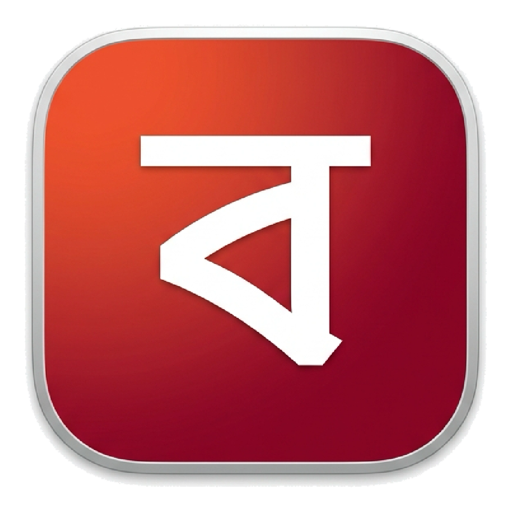
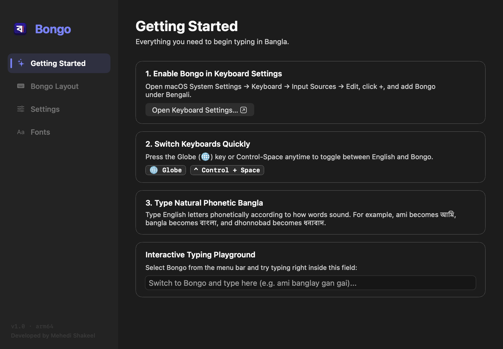
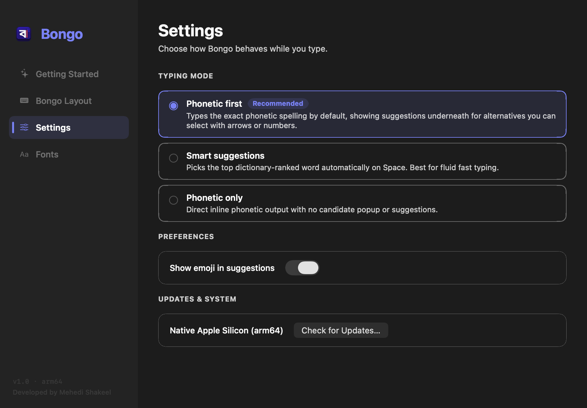
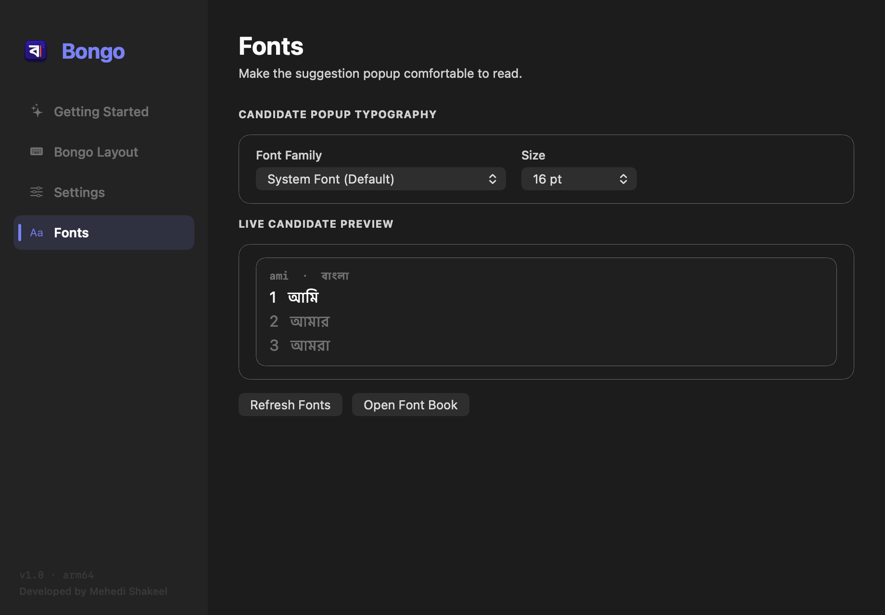
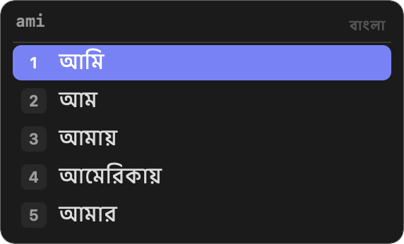

<p align="center">
  
</p>

<h1 align="center">Bongo · বঙ্গ</h1>

<p align="center">
  <strong>Native Bangla Phonetic Keyboard for macOS, Linux, Windows & Android</strong>
</p>

<p align="center">
  <a href="https://github.com/mehedishakeel/Bongo/releases/latest"></a>
  <a href="LICENSE"></a>
  <a href="https://getbongo.app"></a>
</p>

<p align="center">
  <a href="https://github.com/mehedishakeel/Bongo/releases/latest/download/Bongo-1.0.1-macos-arm64.dmg">
    
  </a>
  &nbsp;
  <a href="https://github.com/mehedishakeel/Bongo/releases/latest/download/Bongo-1.0.1-macos-intel-x86_64.dmg">
    
  </a>
  &nbsp;
  <a href="https://github.com/mehedishakeel/Bongo/releases/latest/download/Bongo-1.0.1-macos-universal.dmg">
    
  </a>
  <br>
  <a href="https://github.com/mehedishakeel/Bongo/releases/latest/download/bongo_1.0.1_amd64.deb">
    
  </a>
  &nbsp;
  <a href="https://github.com/mehedishakeel/Bongo/releases/latest/download/bongo_1.0.1_arm64.deb">
    
  </a>
  <br>
  <a href="https://github.com/mehedishakeel/Bongo/releases/latest/download/Bongo-Setup-1.0.1.exe">
    
  </a>
  &nbsp;
  <a href="https://github.com/mehedishakeel/Bongo/releases/latest/download/Bongo-1.0.1-x64.msi">
    
  </a>
  &nbsp;
  <a href="https://github.com/mehedishakeel/Bongo/releases/latest/download/Bongo-1.0.1-windows-portable.zip">
    
  </a>
  <br>
  <a href="https://github.com/mehedishakeel/Bongo/releases/latest/download/Bongo-1.0.1-android.apk">
    
  </a>
</p>

---

**Bongo** is a fast, lightweight, and modern Bengali input method built natively for macOS (Apple Silicon M1/M2/M3/M4+ and Intel x86_64), modern Linux desktop environments (GNOME, KDE Plasma, XFCE, Hyprland, Omarchy), Windows (Windows 10 & 11), and Android smartphones & tablets. It brings familiar phonetic typing directly into all your applications with instant suggestions, a sleek candidate HUD/strip, and complete on-device privacy.

**Visit the official website & interactive demo**: [https://getbongo.app](https://getbongo.app)

---

## Quick Installation

### macOS (Apple Silicon & Intel)

#### Option 1: Via Homebrew (Recommended)
```bash
brew install --cask mehedishakeel/bongo/bongo
```

#### Option 2: Via Direct DMG Download
1. **Download**: Get `Bongo-1.0.1-macos-arm64.dmg` (for Apple Silicon) or `Bongo-1.0.1-macos-intel-x86_64.dmg` (for Intel) from [Releases](https://github.com/mehedishakeel/Bongo/releases/latest). A Universal 2 DMG (`Bongo-1.0.1-macos-universal.dmg`) is also available.
2. **Install**: Open the DMG and drag **Bongo.app** into your **Applications** folder.
3. **Activate**:
   - Open **Bongo** from Applications once (it registers the keyboard service with macOS).
   - Go to **System Settings -> Keyboard -> Input Sources -> Edit -> +**, and select **Bongo** (under Bengali).
   - Switch keyboards anytime with the **Globe (<kbd>fn</kbd> / Globe)** key or <kbd>Control + Space</kbd>!

See [docs/MACOS-INSTALL.md](docs/MACOS-INSTALL.md) or [platforms/macos/README.md](platforms/macos/README.md) for details.

### Linux (Ubuntu, Debian, Fedora, Arch, Omarchy)

#### Option 1: Universal tarball (any distribution)
1. **Download**: Get `Bongo-1.0.1-linux-x86_64.tar.gz` (64-bit PC) or `Bongo-1.0.1-linux-aarch64.tar.gz` (ARM64) from [Releases](https://github.com/mehedishakeel/Bongo/releases/latest).
2. **Install**:
   ```bash
   tar -xzf Bongo-1.0.1-linux-x86_64.tar.gz
   cd Bongo-1.0.1-linux-x86_64
   sudo bash install.sh --prebuilt
   ```
   The tarball needs glibc 2.39+ (Ubuntu 24.04+, Debian 13+, Fedora 40+, Arch) and Python 3 + GTK 4 for the settings app. The installer verifies every file against `MANIFEST.sha256` and installs the matching architecture only.
3. **Activate**: The installer detects your desktop and enables Bongo automatically:
   - **GNOME / IBus**: added to your GNOME input sources; toggle with <kbd>Super + Space</kbd>.
   - **KDE / Hyprland / Omarchy / fcitx5**: added to the fcitx5 profile; switch with <kbd>Ctrl + Space</kbd>.
4. **Uninstall** (from the extracted folder):
   ```bash
   sudo bash install.sh --uninstall
   ```

#### Option 2: Debian / Ubuntu package
1. **Download**: Get `bongo_1.0.1_amd64.deb` (standard 64-bit PC) or `bongo_1.0.1_arm64.deb` (ARM64) from [Releases](https://github.com/mehedishakeel/Bongo/releases/latest).
2. **Install**:
   ```bash
   sudo apt install ./bongo_1.0.1_amd64.deb
   ```
   These packages use the same glibc 2.39+ floor (Ubuntu 24.04+, Debian 13+).
3. **Activate**: Add **Bengali (Bongo)** under **Settings -> Keyboard -> Input Sources** (GNOME), or run `fcitx5-configtool` and add **Bongo** (KDE / Hyprland / Omarchy).

#### Option 3: Build from source
For older distributions or development:
```bash
sudo ./platforms/linux/scripts/install.sh
```
The installer builds the fcitx5 addon automatically when its development headers are present; set `BONGO_FCITX5=0` to skip it.

See [docs/LINUX-INSTALL.md](docs/LINUX-INSTALL.md) or [platforms/linux/README.md](platforms/linux/README.md) for details.

### Windows (Windows 10 & 11)

- **Installer (Recommended)**: Download `Bongo-Setup-1.0.1.exe` (or `Bongo-1.0.1-x64.msi` for enterprise deployment) from [Releases](https://github.com/mehedishakeel/Bongo/releases/latest) and run setup.
- **Portable ZIP**: Download `Bongo-1.0.1-windows-portable.zip`, extract anywhere, and run `bongo.exe`. No installation or administrator permissions required!
- **Activate**:
  - Press <kbd>F12</kbd> anywhere (browsers, Word, Notepad, IDEs) to toggle between Bangla and English mode.
  - Access settings, fonts, and layout cheat sheets anytime from the system tray icon or Start Menu.

See [docs/WINDOWS-INSTALL.md](docs/WINDOWS-INSTALL.md) or [platforms/windows/README.md](platforms/windows/README.md) for details.

### Android (Smartphones & Tablets)

1. **Download**: Get `Bongo-1.0.1-android.apk` from [Releases](https://github.com/mehedishakeel/Bongo/releases/latest).
2. **Install**: Tap the downloaded APK to install. Allow "Install unknown apps" in Android settings if prompted.
3. **Activate**:
   - Open **Bongo Settings** from your app drawer.
   - Follow the 2-step setup: **Enable Bongo Keyboard** in System Settings, then **Select Bongo Keyboard** as your active input method.
   - Open any app to type! Switch between English and Bangla via the Space key or Globe key, swipe left on Backspace to erase words, or glide on Spacebar for smooth cursor scrubbing.

See [platforms/android/README.md](platforms/android/README.md) for details.

---

## How to Type

Bongo uses the standard, intuitive **Avro Phonetic** rules you already know. Type Bengali words according to how they sound in English letters:

| English Keystrokes | Bangla Output | Meaning |
|:---|:---|:---|
| `ami` | **আমি** | I / Me |
| `bangla` | **বাংলা** | Bengali |
| `dhonnobad` | **ধন্যবাদ** | Thank you |
| `shonar bangla` | **সোনার বাংলা** | Golden Bengal |
| `kemon achen` | **কেমন আছেন** | How are you? |
| `kkhoma` | **ক্ষমা** | Forgive |
| `gyan` / `jnj` | **জ্ঞান** | Knowledge |

Press <kbd>Space</kbd> to commit the highlighted word, or press number keys <kbd>1</kbd> to <kbd>9</kbd> to pick from the candidate list immediately.

---

## Key Features

- **Pure Rust Engine**: High-performance, zero-latency phonetic transliteration powered by offline dictionary Trie structures.
- **Privacy-First (On-Device)**: Your typing, vocabulary, and preferences never leave your device. No network calls, no analytics, and no telemetry.
- **Modern Candidate HUD**: Floating suggestion bar with tactile shortcut keys (`[1]`, `[2]`), arrow navigation, and high-contrast styling.
- **3 Typing Modes**: Choose between *Phonetic first* (exact phonetic spelling by default), *Smart suggestions* (dictionary auto-selection), or *Phonetic only* (direct inline output).
- **Native Linux Frontends**: IBus integration for GNOME and a native fcitx5 addon for KDE Plasma, Hyprland, Omarchy, and other fcitx5 desktops, both sharing the same Rust engine.
- **Custom Fonts**: Choose any Bengali font installed on your system (Noto Sans Bengali, Kalpurush, Kohinoor Bangla, SolaimanLipi, etc.) with real-time size adjustments. The fcitx5 candidate window follows the active fcitx5 theme.
- **Desktop Settings & Cheatsheet**: Native welcome and settings application across macOS, Linux, and Windows with searchable layout guide and interactive typing playground.

---

## Screenshots

<p align="center">
  
  <br>
  <em>Frictionless Onboarding: One-click setup guide, layout cheat sheet, and live typing verification</em>
</p>

<p align="center">
  
  <br>
  <em>Visual Phonetic Key Map: Complete consonant, vowel, and compound ligature mapping with instant search</em>
</p>

<p align="center">
  
  <br>
  <em>Typing Modes & Preferences: Flexible phonetic modes, auto-correction, and system integration</em>
</p>

<p align="center">
  
  <br>
  <em>Typography Customizer: Real-time font family selection and candidate size preview</em>
</p>

<p align="center">
  
  <br>
  <em>Tactile Candidate HUD with fast numbered shortcuts (1–9) and keyboard navigation</em>
</p>

---

## For Developers

### Build on macOS:
```sh
./platforms/macos/scripts/create-dmg.sh release
```

### Build on Linux:
```sh
# System-wide install with both IBus and fcitx5 frontends:
sudo ./platforms/linux/scripts/install.sh

# Or create DEB / universal tarball packages:
./platforms/linux/scripts/build-deb.sh
./platforms/linux/scripts/build-tarball.sh
```

### Build on Windows:
```cmd
platforms\windows\scripts\build-windows.bat
```

### Build on Android:
```sh
cd platforms/android && ./gradlew assembleDebug
```

### Run Tests:
```sh
python3 -m unittest discover -s tests -v
```

See [docs/BUILDING.md](docs/BUILDING.md) and [docs/ARCHITECTURE.md](docs/ARCHITECTURE.md) for full developer documentation.

---

## Credits & License

Bongo is developed and maintained by **[Mehedi Shakeel](https://github.com/mehedishakeel)**.

- **Foundational Architecture**: Derived from [Lekho](https://github.com/ARahim3/Lekho) by Abdur Rahim.
- **Phonetic Engine**: Powered by [riti](https://github.com/OpenBangla/riti) (OpenBangla contributors).
- **Phonetic Layout Scheme**: Avro Phonetic scheme by OmicronLab (Dr. Mehdi Hasan Khan).

Licensed under the **[Mozilla Public License 2.0 (MPL-2.0)](LICENSE)**.
